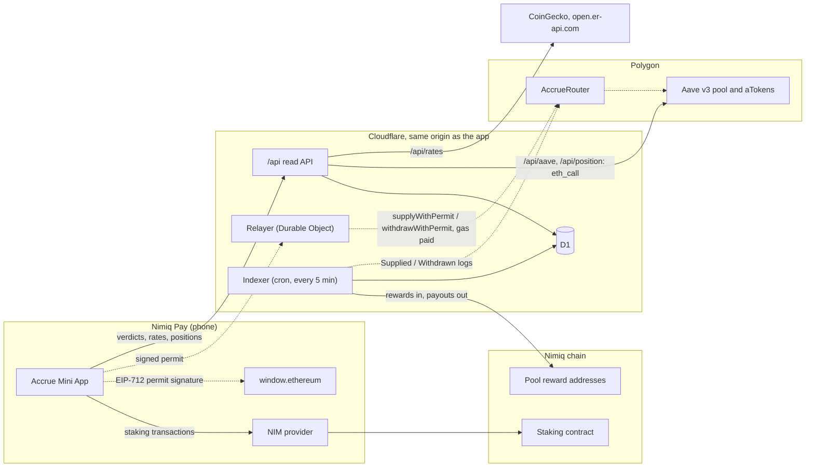

# Accrue

**Your NIM and dollars, earning, inside Nimiq Pay.** Put USDT or USDC on Polygon into Aave v3 with one
signature and no gas token. Stake NIM with a pool after checking, from the chain, that it actually pays its
stakers.

[Open in Nimiq Pay](https://nimpay.app/miniapps/open/accrue.pages.dev) ·
[Web page and checker](https://accrue.pages.dev) ·
[Five-minute review path](JUDGES.md) ·
[Claims and evidence](CLAIMS.md) ·
[Proof](PROOF.md) ·
[Payout Check methodology](METHODOLOGY.md) ·
[Security](SECURITY.md) ·
[What is simulated](MOCKS.md)

## What it does

- **Dollars.** Deposit USDT (USDT0) or native USDC on Polygon into Aave v3 from $1, and withdraw the same way.
  You sign one EIP-2612 permit; Accrue's relayer pays the network fee, so you need no POL. The permit names
  Accrue's router, which can only supply your tokens to Aave in your name or redeem your aTokens back to your
  own wallet. Each sheet says what you sign, to whom, what happens next and who pays the fee.
- **NIM.** Stake with a listed pool, add to a stake, switch pool, unstake in guided steps with a countdown, and
  restake rewards a pool paid to your wallet. The network's staking rules (minimums, lock-ups, what a pool
  change needs) are checked before Nimiq Pay opens a dialog, so a transaction the chain would refuse is not sent.
- **Payout Check.** For your pool: what your stake should have received after the fee, against what reached
  you. For every listed pool: a verdict from its own transactions on the Nimiq chain. Verdicts stay neutral and
  say "not enough data" rather than guess. [How it decides](METHODOLOGY.md).
- **Home.** Everything that earns, in your own currency (the fiat Nimiq Pay is set to), with Aave interest
  ticking live, what changed since your last visit and what is due next.
- **Activity.** Every action with its receipt and a link to the chain.
- **Outside Nimiq Pay**, [accrue.pages.dev](https://accrue.pages.dev) shows the pool scoreboard and a read-only
  checker: paste a NIM address for its pool's verdict, or a 0x address for its Aave position.

The app speaks English, German, Spanish, French and Portuguese, following Nimiq Pay's language.

## Who it is for

People who hold dollars or NIM in Nimiq Pay and want them to earn, without buying a gas token, without leaving
the app, and without taking a staking pool's word for what it pays.

## Why

- **Dollars in a wallet earn 0 %.** Aave v3 on Polygon pays a variable supply rate (the Dollars screen shows
  today's, read from the Aave pool), but every direct route to it needs POL for gas. A Nimiq Pay user usually
  holds none and cannot buy it inside the app, so the route dead-ends on the first transaction.
- **NIM pools pay on trust.** The network pays staking rewards to each validator's reward address. The pool
  then decides when and how much to pass on to its stakers. Nothing on chain enforces it, and stakers had no
  easy way to see whether their pool does.

## How it works

<!-- numbers:architecture -->



Solid lines are live. Dotted lines wait for the router deployment: until `packages/shared/src/deployments.json` names the router, the app asks for no permit, the relayer has nothing to call, and the app says dollar deposits are not open yet.

<!-- /numbers:architecture -->

**A deposit, step by step.** The app reads the token's permit nonce and asks Nimiq Pay to sign an EIP-712
`Permit(owner, spender = router, value, nonce, deadline)` valid for 20 minutes. It posts the signature to
`/api/relay`. The Worker checks the request before any gas is spent: asset allowlist, $1 minimum and $10,000
cap, deadline between 60 seconds and 60 minutes away, signer recovery, the owner's balance and permit nonce,
10 relays per owner per 24 hours, then an `eth_call` simulation. The relayer (a Durable Object: one writer, one
nonce sequence) records the job before it broadcasts, follows the receipt, raises the tip if a transaction is
stuck, and replaces it with a cancel before the permit's deadline rather than let it land late. A repeated
request with the same signature returns the same job and never sends twice.

On chain, `AccrueRouter.supplyWithPermit` submits the permit, pulls the tokens and supplies them to Aave with
`onBehalfOf = owner`, so the aTokens are minted straight to the owner's wallet. `withdrawWithPermit` does the
reverse and sends the underlying straight to the owner. The router has no owner, no admin, no upgrade path and
no fee.

If the relayer is down, out of gas or out of its daily budget, the sheet says so and, if the wallet holds enough
POL, offers to send the same signed permit as an ordinary transaction from the wallet, fee paid by the user.
Withdrawals never depend on Accrue: the aTokens sit in the owner's wallet and can be redeemed on Aave directly.

**Payout Check.** A cron job runs every 5 minutes, reads the listed pools' reward addresses from the Nimiq chain
(the pools with the most new transactions first) and keeps hourly and daily totals of what came in from the
network and what went out to stakers. Over the last
7 days of data it compares what a pool passed on with what it promised (`1 − fee`), and checks how long ago it
last paid against its published schedule. The rules, thresholds and their validation are in
[METHODOLOGY.md](METHODOLOGY.md).

**Router:** <!-- numbers:router -->deployment pending: no address is published yet<!-- /numbers:router -->.

## Nimiq integration

Everything below runs inside Nimiq Pay through `@nimiq/mini-app-sdk` 0.2.5 and the providers the host injects.

- **NIM accounts:** `listAccounts` (the wallet and, when present, its HTLC account; spendable NIM often sits in
  the HTLC, so both are summed) and `getBalance`.
- **Staking, all six transaction types:** `sendNewStakerTransaction`, `sendStakeTransaction`,
  `sendSetActiveStakeTransaction`, `sendUpdateStakerTransaction`, `sendRetireStakeTransaction` and
  `sendRemoveStakeTransaction`, with the network's rules checked first: 100 NIM minimum, never between 0 and
  100 NIM left behind, a pool change only once the stake is inactive and released, removal of the whole retired
  balance. The refusals behind these rules were seen with real transactions on Nimiq testnet
  ([PROOF.md](PROOF.md#nimiq-testnet)); the release timing comes from the protocol source.
- **Read-only Nimiq RPC through the host:** `getStakerByAddress`, `getAccountByAddress`, `getBlockNumber`,
  `getPolicyConstants`, `getValidatorByAddress` (jail state for the unstake countdown), `getTransactionByHash`
  (to confirm or fail every staking transaction after it is sent) and `getTransactionsByAddress` (Activity).
- **Polygon through `window.ethereum`:** `eth_requestAccounts`, `eth_chainId`, `wallet_switchEthereumChain` and
  `wallet_addEthereumChain` (hex chain id `0x89`), `eth_signTypedData_v4` for the EIP-712 permits, and
  `eth_sendTransaction` with `eth_getTransactionReceipt` only for the pay-the-fee-yourself fallback.
- **Host context:** `nimiqPay.language` picks the language, `nimiqPay.userFiat` the currency every value is shown
  in (USD, EUR, CRC or GMD), and `nimiqPay.network` switches the NIM screens to testnet, with a badge.
- **Mini App rules:** nothing asks the wallet before the first tap, one tap never opens two dialogs, a missing
  provider and a cancelled dialog are ordinary states, 375 px minimum width, 44 px tap targets, a safe-area inset
  at the bottom. The deep link `nimpay.app/miniapps/open/accrue.pages.dev` opens the app at `/`.

## Run it locally

```sh
pnpm install && pnpm dev
```

Then open <http://localhost:5173/?mock=happy>. In development builds `?mock=<scenario>` stands in for Nimiq
Pay, its wallets and Accrue's API, so every screen and every outcome can be driven from a desktop browser.
[MOCKS.md](MOCKS.md) lists the scenarios and what is real in production. Without `?mock=` the same URL shows the
landing page.

To run the API as well, start the Worker in a second terminal (`pnpm --filter @accrue/worker dev`, after
applying the migrations in `worker/migrations/` to a local D1); the app's dev server proxies `/api` to it.
Requirements: Node 24 and pnpm 9. The contract suites need Foundry and an archive Polygon RPC.

## Configuration

| Name | Where | Purpose |
|---|---|---|
| `NIM_RPCS` | `worker/wrangler.toml` | Comma-separated Nimiq JSON-RPC endpoints, tried in order. Default `https://rpc.nimiqwatch.com`. |
| `POLYGON_RPCS` | `worker/wrangler.toml` | Comma-separated Polygon RPC endpoints; the relayer broadcasts to all of them. |
| `RELAYER_ADDRESS` | `worker/wrangler.toml` | Public address of the relayer key; `/api/health` reports its POL balance. |
| `RELAYER_KEY` | Worker secret (`.dev.vars` locally) | The relayer's hot key. It pays gas and cannot move user funds anywhere but back to their owner. |
| `ROUTER_ADDRESS` | `worker/wrangler.toml`, optional | Overrides the router in `packages/shared/src/deployments.json`. |
| `ROUTER_DEPLOY_BLOCK` | `worker/wrangler.toml`, optional | Deploy block of an overriding router, where its event scan starts. |
| `DB`, `RELAYER`, cron | `worker/wrangler.toml` | D1 database, relayer Durable Object, indexer schedule `*/5 * * * *`. |
| `CORE` | `app/wrangler.toml` | Service binding from the Pages project to the Worker; `app/functions/api/[[path]].ts` forwards `/api/*`. |
| `POLYGON_RPC` | shell | Polygon RPC. `forge test` needs it set to an archive endpoint (the fork is pinned to a block); `collect-results.mjs` passes `https://polygon.drpc.org` to forge when it is unset. Both scripts read Polygon from it when set, otherwise from publicnode, drpc and 1rpc in turn (`scripts/lib/deployment.mjs`). |
| `ACCRUE_ORIGIN` | shell | Origin the scripts read `/api/*` from. Default `https://accrue.pages.dev`. |
| `ACCRUE_DEPLOYER_PK` | shell | Deployer key for `contracts/script/Deploy.s.sol`; without it the script only simulates. |

The deployed router's address and block live in `packages/shared/src/deployments.json`, which the app, the
Worker and the scripts all read.

## Tests

<!-- numbers:tests -->

| Suite | Command | Tests | Result | Detail | Recorded |
|---|---|---:|---|---|---|
| Router (Foundry, Polygon fork) | `cd contracts && forge test` | 26 | 26 passed | 3 suites; 2 fuzz tests at 256 runs; invariant campaign 64 runs × 20 calls | 2026-11-08, forge 1.8.3 |
| Shared logic: permits, payout math | `pnpm --filter @accrue/shared test` | 66 | 66 passed | 4 files | 2026-11-08, vitest 3.2.4 |
| Worker: relayer, indexer, API | `pnpm --filter @accrue/worker test` | 248 | 248 passed | 17 files | 2026-11-08, vitest 3.2.4 |
| App: flows, models, providers | `pnpm --filter @accrue/app test` | 493 | 493 passed | 28 files | 2026-11-08, vitest 3.2.4 |
| App end to end (Playwright) | `pnpm --filter @accrue/app e2e` | 169 | 164 passed, 5 skipped | app-375 44, app-430 44, desktop-1440 27, mobile-375 27, wide-1920 27 | 2026-11-08, playwright 1.64.1 |
| **Total** | | **1,002** | 997 passed, 5 skipped | | |

Recorded by `node scripts/collect-results.mjs` into [`results/`](results/), testing the code at commit `2ea69bd47d9e81ca6c596c7d387423002462e8e5`. The skipped end-to-end cases are QR-code checks that apply only to a computer or only to a phone viewport.

<!-- /numbers:tests -->

The contract suites fork Polygon at a pinned block and run against the real Aave v3 pool, aTokens, USDT0 and
USDC, with fuzzing and an invariant campaign ([SECURITY.md](SECURITY.md)). The Payout Check rules are tested on
recorded mainnet transactions and on synthetic payout histories, including cut-anywhere sweeps and short-paying
negative controls ([METHODOLOGY.md](METHODOLOGY.md#validation)).

Re-collect and re-render:

```sh
node scripts/collect-results.mjs          # runs every suite, fetches the live scoreboard, writes results/*.json
node scripts/render-readme-numbers.mjs    # fills the numbers in these docs from results/*.json
node scripts/verify-onchain.mjs           # checks the chain and the live app, one PASS / FAIL line per check
```

## Honest limits

- **The router has had no external audit.** [SECURITY.md](SECURITY.md) records the in-house review, its findings
  and the risks accepted on purpose. Funds sit in Aave v3, so Aave's risks apply too, and the USDT0 and USDC
  issuers can freeze addresses.
- **Gas is sponsored within limits:** $1 minimum and $10,000 per deposit, 10 relays per address per 24 hours,
  and a daily gas budget. When the relayer cannot send, the user can pay the fee in POL, or withdraw on Aave
  directly.
- **USDC needs a plain key-based wallet.** Circle's USDC checks permits with ERC-1271 when the owner address has
  code (for example an EIP-7702 delegation), so such a permit may fail; the relayer refuses USDC deposits from
  those addresses and says so. USDT0 is not affected.
- **Payout Check reads public data; it is not an audit of a pool.** It cannot see off-chain agreements. A fee
  sent to an operator wallet that also stakes in the pool counts as paid. Pools whose payouts fill most of their
  own cycle get "not enough data" rather than a verdict, and a single staker is only called short when the whole
  pool is. [METHODOLOGY.md](METHODOLOGY.md#honest-limits) lists every limit.
- **The indexer reads one public Nimiq RPC.** If it falls behind, each verdict carries a "data as of" reason and
  `/api/health` reports the lag.
- **Unstake timing comes from the protocol's rules.** The testnet transactions in [PROOF.md](PROOF.md#nimiq-testnet)
  show the lock and the refusals; the release block itself (one epoch plus one block after the election block
  that starts the wait) is computed from the protocol source, and the countdown turns blocks into time with the
  block time the network reports in `getPolicyConstants`.
- **On testnet** only the NIM screens switch; dollars always run on Polygon mainnet, and Payout Check has no
  testnet data.
- **"Since your last visit"** is kept on the phone and is best effort; without it Home shows an estimate for the
  last 24 hours and says so.

## License

[MIT](LICENSE).
